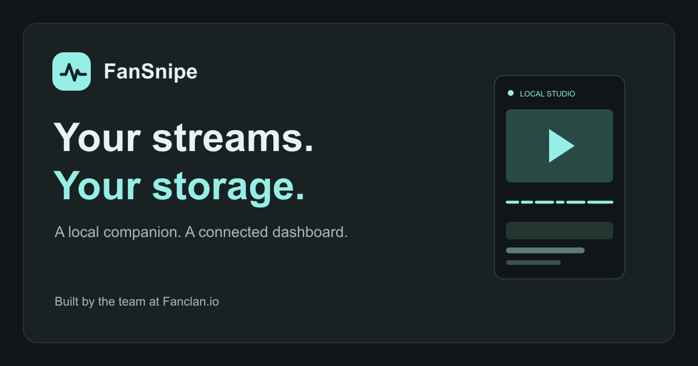

# FanSnipe Companion

**Local stream recording for macOS, Windows, and Docker — by the team at [Fanclan.io](https://fanclan.io).**



FanSnipe pairs a web dashboard with a recording engine on your own computer. Follow channels, record live streams, browse your library, and play or download recordings without uploading them to Fanclan.

Maintained by [zerodayprime](https://github.com/zerodayprime) in the [Fanclan organization](https://github.com/Fanclan). The website and shared dashboard live in [FanSnipe Portal](https://github.com/Fanclan/FanSnipe-Portal).

The project website and dashboard are at [fansnipe.com](https://fansnipe.com).

## Where recordings go

```text
Streaming source → your companion → your recording folder
                                   ↘ your S3 bucket (optional)

Fanclan website → static dashboard → direct local connection
```

Recordings, thumbnails, previews, recording history, and storage credentials stay on your hardware. Optional S3 uploads travel directly from your companion to your own bucket. Fanclan does not operate a media relay or recording-storage service.

## Features

- Manual recording and automatic channel monitoring.
- A searchable recording library with channel details, status, quality, and storage information.
- Local playback, seeking, downloads, thumbnails, and previews.
- Durable recording state, interrupted-recording recovery, and safe retention.
- A paired browser dashboard and a bundled local dashboard.
- Optional direct backups to an S3-compatible bucket you control.
- Desktop tray controls and an all-in-one self-hosted Docker distribution.

The recording engine uses yt-dlp and FFmpeg. Individual platform compatibility can change; release notes distinguish verified integrations from unverified ones. A platform URL being publicly accessible does not by itself grant permission to record its content.

## Downloads and setup

Use [GitHub Releases](https://github.com/Fanclan/FanSnipe-Companion/releases) for published builds and their verification reports. Only assets present in a release are available; a platform listed as a target is not a claim that an installer has been published.

Target platforms are macOS 13+ (Apple Silicon and Intel), Windows 11 x64, and Linux Docker hosts (AMD64 and ARM64). Desktop beta releases are labeled separately from signed stable releases.

1. Install the companion and select a recording folder.
2. Open the dashboard from the companion, or use the hosted portal in Chrome or Edge.
3. Approve browser access and pairing on your computer.
4. Add a channel or start a recording.

Closing the dashboard does not stop the companion. Recording requires the companion to remain running and the computer to remain awake. Explicitly quitting the companion stops active jobs gracefully.

## Docker

This repository owns the Docker image and Compose configuration; no separate Docker repository is needed. The image includes the engine, dashboard, and media tools. Use the checked-in Compose configuration and the packaging documentation for build and volume configuration.

The planned image namespace is `ghcr.io/fanclan/fansnipe`. Use a versioned release tag or digest verified in the release manifest. Published ports default to host loopback. For a NAS or another computer, use that instance's own dashboard with authentication and an HTTPS reverse proxy; the hosted portal's localhost connection targets the computer running your browser.

Recordings and application data belong in persistent user-managed volumes. Container replacement must preserve those volumes.

## Development and API

The companion owns the `/api/v1` contract, recording engine, SQLite catalog, and desktop/Docker packaging. The portal owns the dashboard source and publishes the immutable dashboard bundle embedded by companion releases.

The local API requires pairing and authentication. Media uses short-lived read tickets so large files can stream and seek without loading the entire recording into browser memory. See the protocol and architecture documentation for supported operations.

Install using the committed lockfile, run the test suite and type checks, and build before packaging. Tests use generated media and local fixtures rather than users' recordings. Packaging pins the dashboard and media tools to recorded versions and checksums.

## Contributing and security

Read [CONTRIBUTING.md](CONTRIBUTING.md) before opening a pull request and [SECURITY.md](SECURITY.md) before reporting a vulnerability. Never attach recordings, tokens, signed media URLs, databases, or unredacted diagnostic logs to public issues.

## License and attribution

FanSnipe is MIT licensed; the original copyright notice is retained in [LICENSE](LICENSE). Bundled tools retain their own licenses and notices. Product development and maintenance are provided by the team at [Fanclan.io](https://fanclan.io), maintained by [zerodayprime](https://github.com/zerodayprime).
