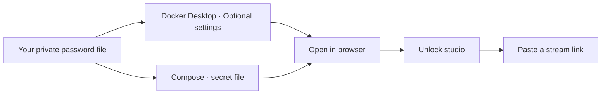

# FanSnipe Companion

**Local stream recording for macOS, Windows, and Docker — by the team at [Fanclan.io](https://fanclan.io).**


FanSnipe pairs a web dashboard with a recording engine on your own computer. Follow channels, record live streams, browse your library, and play or download recordings without uploading them to Fanclan.

Maintained by [zerodayprime](https://github.com/zerodayprime) in the [Fanclan organization](https://github.com/Fanclan). The website and shared dashboard live in [FanSnipe Portal](https://github.com/Fanclan/FanSnipe-Portal).

The project website and dashboard are at [fansnipe.com](https://fansnipe.com).

## Where recordings go

```text
Streaming source → your companion → your recording folder
                                   ↘ your S3 bucket (optional)

Fanclan website → static dashboard → direct local connection
```

Recordings, thumbnails, previews, recording history, and storage credentials stay on your hardware. Optional S3 uploads travel directly from your companion to your own bucket. Fanclan does not operate a media relay or recording-storage service.

## Features

- Manual recording and automatic channel monitoring.
- A searchable recording library with channel details, status, quality, and storage information.
- Local playback, seeking, downloads, thumbnails, and previews.
- Durable recording state, interrupted-recording recovery, and safe retention.
- A paired browser dashboard and a bundled local dashboard.
- Optional direct backups to an S3-compatible bucket you control.
- Desktop tray controls and an all-in-one self-hosted Docker distribution.

The recording engine uses yt-dlp and FFmpeg. It accepts Twitch, YouTube, Kick and Chaturbate links, plus Picarto, Stripchat and BongaCams channel pages. Use streams you own or have permission to record where the platform permits recording. FanSnipe combines separate audio and video tracks locally when the site provides them. Individual platform compatibility can change; release notes distinguish verified integrations from unverified ones. A platform URL being publicly accessible does not by itself grant permission to record its content.

## Downloads and setup

Get the macOS 13+ installer for Apple Silicon or Intel, or the Windows 11 x64 installer, from the [FanSnipe desktop 0.1.3 beta release](https://github.com/Fanclan/FanSnipe-Companion/releases/tag/desktop-v0.1.3-beta.1). These desktop builds are unsigned, and the macOS builds are unnotarized. The eight-hour Windows 11 recording test is deferred.

Docker is available for Linux AMD64 and ARM64. [Docker 0.1.3 beta release and checksums](https://github.com/Fanclan/FanSnipe-Companion/releases/tag/docker-v0.1.3-beta.1)

1. Install the companion and select a recording folder.
2. Open the dashboard from the companion, or use the hosted portal in Chrome or Edge.
3. Approve browser access and pairing on your computer.
4. Add a channel or start a recording.

Closing the dashboard does not stop the companion. Recording requires the companion to remain running and the computer to remain awake. Explicitly quitting the companion stops active jobs gracefully.

Upgrading from StreamSnipe: quit the old companion before starting FanSnipe. If no FanSnipe catalog exists, the desktop companion reuses an existing StreamSnipe catalog in place. If both exist, it uses the FanSnipe catalog and leaves the old one untouched.

## Docker

The Docker image includes the recording engine, local studio, and media tools. Keep its data and recording volumes when upgrading.

From a checkout containing [compose.yaml](compose.yaml), select the published release and start the service.

```sh
export FANSNIPE_VERSION=docker-v0.1.3-beta.1
docker compose pull fansnipe
docker compose up -d fansnipe
```

The image is `ghcr.io/fanclan/fansnipe:docker-v0.1.3-beta.1`. Its verified multiarchitecture index digest is `sha256:9f6828664fac253437152256c656419920a09da7beb55fee59c190d1f2fef9ec`. [Image manifest and checksums](https://github.com/Fanclan/FanSnipe-Companion/releases/tag/docker-v0.1.3-beta.1)

Open the bundled dashboard at [127.0.0.1:47821/app/](http://127.0.0.1:47821/app/). Compose binds to loopback by default. For a NAS or another computer, use that instance's dashboard with authentication and an HTTPS reverse proxy.

Recordings and application data belong in persistent user-managed volumes. When upgrading an existing StreamSnipe Compose installation, stop active recordings and the old `streamsnipe` service with its original project name, retain both volumes, and start FanSnipe with the same project name. See the [Compose upgrade details](desktop/PACKAGING.md) before changing project names or directories.

Starting with Docker 0.1.2, you can also connect [fansnipe.com/app](https://fansnipe.com/app/) to Docker on the same computer. Enable `FANSNIPE_HOSTED_DASHBOARD=true`, keep the default loopback port binding, and approve pairing in the local page opened by the website. Enter the setup token only in that local page. The bridge is off by default and cannot be combined with `FANSNIPE_PUBLIC_ORIGIN`; see the [hosted Docker setup](desktop/PACKAGING.md) for instructions. Recordings still travel directly from Docker to your browser.

### Unlock the local studio with your own password

Password-enabled companion releases let you unlock the bundled studio in the same browser tab. Check the downloads page for the current release. Save a private UTF-8 plain-text file called `fansnipe_studio_password` containing a passphrase of your choice (one line, 8–1024 bytes). Your password manager can remember it. A running companion detects the first valid file in a mounted setup folder when you open or refresh the studio. On native Linux hosts, grant the container user (UID 1000) read access to the mounted file and traversal of its parent folder.



**Docker Desktop**

1. When creating the FanSnipe container, open **Images → Run → Optional settings**. Set host port **47821** for container port **47821**. For a studio on this computer, choose the localhost port-binding default in Docker Desktop’s network settings. [Docker Desktop network settings](https://docs.docker.com/desktop/features/networking/#how-exposed-ports-work)
2. In **Volumes**, set the host path to your private password file and the container path to `/run/secrets/fansnipe_studio_password`. Use a read-only mount where available. If your file picker selects folders only, place the file in a dedicated folder, name it exactly `fansnipe_studio_password`, and mount that folder at `/run/secrets`. Use persistent volumes for `/data` and `/media`.
3. Start the container. In **Containers**, click its port or **Open in browser**. Enter your password on the local **Unlock studio** screen. A returning browser with a current session opens directly to the studio. [Docker Desktop container settings](https://docs.docker.com/desktop/use-desktop/images/#run-an-image-as-a-container)

**Docker Compose**

1. Save the private file alongside the Compose files or set `FANSNIPE_STUDIO_PASSWORD_SOURCE` to its absolute host path. The default filename is ignored by Git and by the image build.
2. Include both configurations when starting or updating your existing Compose project. The overlay mounts the file as a Docker secret. Keep the same Compose project name to retain your catalog and media. [How Compose secrets work](https://docs.docker.com/compose/how-tos/use-secrets/)

```sh
docker compose -f compose.yaml -f compose.studio-password.yaml up -d fansnipe
```

3. Open [your local studio](http://127.0.0.1:47821/app/) and enter your password. Subsequent visits use the remembered session until it expires or you revoke it in Settings.

**Change or recover a password.** Replace the private file and recreate the container with the same mounts and volumes so Docker remounts the updated file. Password-created browser sessions must unlock again. Existing operator-approved pairings and upload destination approvals keep their existing authentication. Removing the password mount and restarting disables password unlock. A shared NAS should use its own studio at its configured `https://` origin behind an HTTPS reverse proxy.

## Development and API

The companion owns the `/api/v1` contract, recording engine, SQLite catalog, and desktop/Docker packaging. The portal owns the dashboard source and publishes the immutable dashboard bundle embedded by companion releases.

The local API accepts a revocable session from studio unlock or pairing. Media uses short-lived read tickets so large files can stream and seek without loading the entire recording into browser memory. See the protocol and architecture documentation for supported operations.

Install using the committed lockfile, run the test suite and type checks, and build before packaging. Tests use generated media and local fixtures rather than users' recordings. Packaging pins the dashboard and media tools to recorded versions and checksums.

## Contributing and security

Read [CONTRIBUTING.md](CONTRIBUTING.md) before opening a pull request and [SECURITY.md](SECURITY.md) before reporting a vulnerability. Never attach recordings, tokens, signed media URLs, databases, or unredacted diagnostic logs to public issues.

## License and attribution

FanSnipe is MIT licensed; the original copyright notice is retained in [LICENSE](LICENSE). Bundled tools retain their own licenses and notices. Product development and maintenance are provided by the team at [Fanclan.io](https://fanclan.io), maintained by [zerodayprime](https://github.com/zerodayprime).
